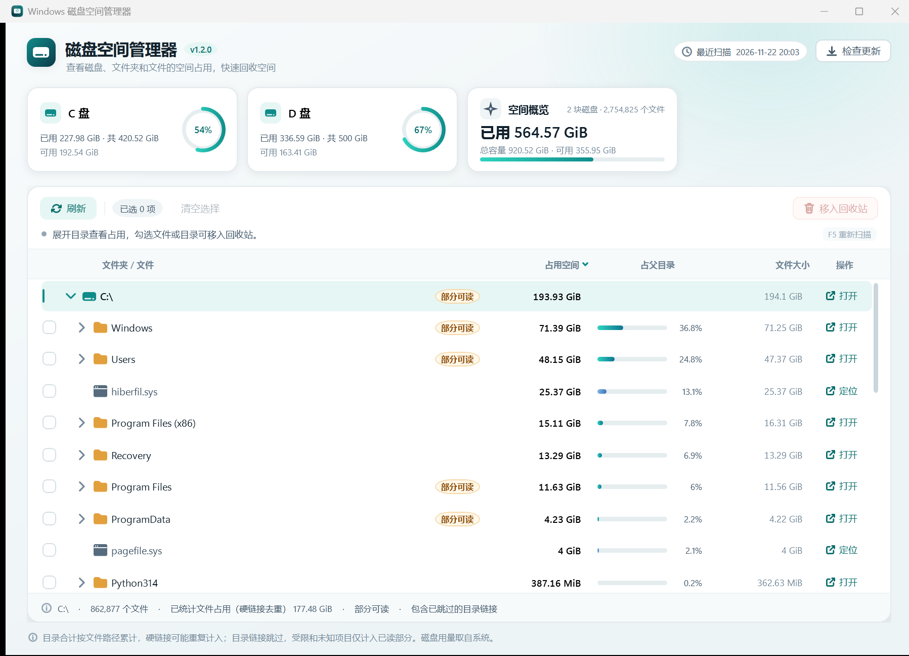

# Windows 磁盘空间管理器

Windows 磁盘空间管理器用一棵可展开的文件树展示每个磁盘、目录和文件的占用。每一层按占用空间从大到小排列，横条表示该项目占父目录的比例。



界面采用现代浅色设计：磁盘用量卡片和环形仪表概览整盘空间，文件按类型显示彩色图标，目录树保持紧凑，扫描、刷新和回收站操作都在同一个工作区内完成。

## 下载和启动

从 [最新的 GitHub Release](https://github.com/peterwangze/windows_disk_manager/releases/latest) 下载文件名以 `-win-x64-Setup.exe` 结尾的安装程序，双击安装。之后可从开始菜单搜索「磁盘空间管理器」。安装作用于当前 Windows 用户，升级会保留已有的扫描快照。

默认安装路径为 `%LOCALAPPDATA%\Programs\WindowsDiskManager`。通过「浏览」可直接选择或新建实际安装目录，例如 `D:\app\WindowsDiskManager`。后续升级会使用已登记的安装路径。旧版自动生成的版本号目录会在首次升级时改用同一安装位置下的固定应用目录。

适用于安装了 .NET Framework 4.8 的 64 位 Windows 10 / 11。使用便携版时，请完整解压同一 Release 的 ZIP 包，保留 `DiskScanner.exe` 和 `scanner-runtime` 文件夹，然后运行 `WindowsDiskManager.exe`。

## 版本与更新

主窗口显示当前版本。点击「检查更新」可查询 GitHub 上的最新正式版。有新版时，点击「下载并自动安装」即可下载、校验并安装，完成后自动重新打开管理器。使用 1.0.0 的用户请先关闭管理器，手动运行一次新版安装 EXE，之后即可在程序内更新。

检查版本、下载安装程序及跟随 GitHub 下载跳转时，都会读取当前用户的 Windows 系统代理设置，遵循自动配置脚本（PAC）、手动代理和系统绕过规则。可以在 Windows「设置 → 网络和 Internet → 代理」中配置。下载完成后，程序会比对 GitHub Release 提供的文件长度和 SHA-256，再启动安装。

## 浏览、刷新和删除

- 首次启动会扫描本机磁盘，以后启动时直接显示上次完成的快照。点击「刷新」或按 **F5** 后，进度面板会显示当前阶段、已扫描目录数、文件数和耗时。扫描期间文件树和操作按钮暂时置灰。点击「取消扫描」或按 **Esc** 可返回上一次快照。扫描成功后，文件树会自动显示新结果。
- 安装或升级后，首次扫描会建立增量基线。之后，本地 NTFS 磁盘通过 Windows 变更日志更新新增、修改、删除和移动的文件与目录，并重算受影响的上级目录及硬链接统计。增量刷新可在普通用户权限下运行。
- 新挂载的磁盘、日志已过期或不可用的磁盘，以及不支持此方式的文件系统会进行全量扫描。其他磁盘可继续增量刷新。全量扫描时，支持并行读取的固态盘会将大型目录树分给多个后台进程。
- 展开目录可查看文件与子目录的占用，鼠标悬停在大小上可查看精确字节数。每行的「打开」或「定位」按钮可在资源管理器中打开目录或选中文件。
- 勾选文件或目录后，点击「移入回收站」，在确认窗口核对完整路径。选择目录会包含其中的内容，重复勾选的子项只处理一次。「查看处理结果」会列出每一项的结果。成功移入回收站的内容可从 Windows 回收站还原，清空回收站后相应空间才会释放。
- 快照生成后发生变化的项目会在删除前重新核对身份。磁盘根目录、管理器自身使用的文件和无法确认身份的项目受保护。

## 统计口径

「占用空间」是文件的已分配字节数，「文件大小」是逻辑长度，两者在压缩、稀疏和小文件上可能不同。目录按照可见文件路径累加，硬链接的多条路径可能指向同一份数据。选择磁盘根节点可以查看按文件标识去重后的已统计占用。磁盘卡片显示 Windows 报告的整盘使用量，其中包括文件系统开销和无法读取的内容。

目录重解析点会作为节点显示并跳过递归遍历。读取受限和占用未知的项目会在树中标记。扫描在一段时间内完成，期间其他程序写入或移动文件可能影响结果。

快照保存在当前用户的 `%LOCALAPPDATA%\WindowsDiskManager`。程序在本机扫描和处理文件。仓库和发布包均不包含个人磁盘快照。

## 从源码构建

在 64 位 Windows 上安装 64 位 Python、.NET Framework 4.8 及 Inno Setup 6.5 或更高的 6.x 版本。桌面程序使用 Framework C# 编译器和系统 SQLite，扫描器使用 Python 标准库。完整构建会在 `dist` 生成带版本号的单文件安装 EXE 和便携 ZIP。

```powershell
python -m pip install PyInstaller==6.19.0
.\build.ps1
.\dist\WindowsDiskManager\WindowsDiskManager.exe
```

构建脚本支持 `-Python <解释器路径>`、`-Part Viewer` 和 `-Part Scanner`。用 `-Part Package` 可根据已经构建好的程序重新生成两个发行文件。若编译器安装在自定义目录，请用 `-InnoCompiler <ISCC.exe 的路径>` 指定。

发布新版时，将应用版本号与 Git 标签对齐（如 `1.2.0` 和 `v1.2.0`）。在同一份正式 Release 中上传构建生成的 `WindowsDiskManager-<版本>-win-x64-Setup.exe`，保留文件名，以便应用识别对应的安装包。

## 隔离验证

`WDM_DATA_DIR` 可为单次运行指定独立的快照目录，`WDM_SCAN_ROOT` 可将扫描范围限制到指定测试目录。使用这两个变量，可在临时目录内验证刷新、文件勾选和移入回收站的完整流程。

完成构建后，可运行下面的回归测试。界面测试会打开临时实例，在生成的测试目录中操作文件，并从回收站还原测试文件。

```powershell
$env:WDM_SCANNER_EXE = (Resolve-Path '.\dist\WindowsDiskManager\DiskScanner.exe').Path
python -B -m unittest discover -s tests -p test_scan.py -v
powershell.exe -NoProfile -STA -File .\tests\recycle.ps1
powershell.exe -NoProfile -STA -File .\tests\ui-smoke.ps1
powershell.exe -NoProfile -STA -File .\tests\scan-feedback.ps1
powershell.exe -NoProfile -File .\tests\update-service.ps1
```

对比扫描性能时，可用 `python tests/benchmark_scan.py --baseline <旧版扫描器.exe> --candidate <新版扫描器.exe> --root <稳定的测试目录>`。默认交替运行三轮，比较端到端耗时中位数，并逐项核对路径、占用、文件标识和目录汇总。
